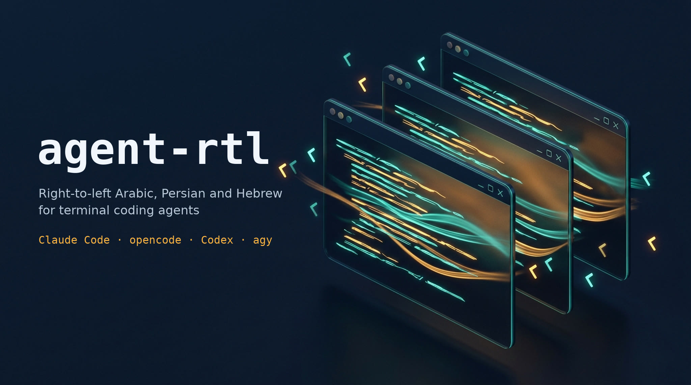
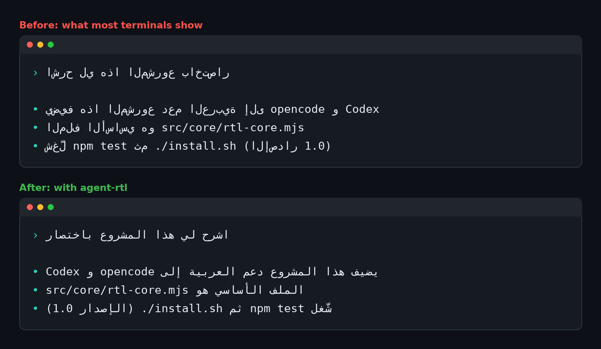

<p align="center">
  
</p>

<p align="center">
  <b>Right-to-left Arabic, Persian and Hebrew in terminal coding agents</b><br>
  Claude Code · opencode · Codex · agy (Antigravity CLI)
</p>

<p align="center">
  <a href="#install">Install</a> ·
  <a href="#how-each-agent-is-fixed">How it works</a> ·
  <a href="#terminal-settings">Terminal settings</a> ·
  <a href="#known-limits">Limits</a>
</p>

Terminal UIs lay text out left to right and draw one letter per cell. So
`مرحبا بالعالم` shows reversed, with every letter in its standalone shape.
agent-rtl repaints each screen row that holds RTL text:

<p align="center">
  
</p>

- **Right to left:** RTL text reads right to left (Unicode Bidirectional
  Algorithm, UAX #9).
- **Joined letters:** each Arabic letter takes its start, middle, end or
  standalone shape from the letters next to it.
- **Technical text stays intact:** English words, commands, paths
  (`./install.sh`, `src/core/rtl-core.mjs`), URLs, flags and numbers inside
  Arabic stay left to right and in one piece.
- **UI details:** brackets are mirrored, and prompt markers (`›`, `>`, `•`)
  stay on the left.

Only what's drawn changes. What you type, copy/paste, and what the model reads
keep the original text.

## Install

One command, straight from GitHub (no clone needed):

```bash
npx -y github:mehbylabs/agent-rtl
```

It shows which agents are installed here and asks what to set up:

```
Install for:
  1) All installed agents (claude opencode codex agy)
  2) Claude Code                      [installed]
  3) opencode                         [installed]
  4) Codex (wrapper, experimental)    [installed]
  5) agy (wrapper, experimental)      [installed]
Choose (e.g. 1, or 3 4):
```

Or skip the menu:

```bash
npx -y github:mehbylabs/agent-rtl install --all -y          # every agent found, no questions
npx -y github:mehbylabs/agent-rtl install opencode codex    # specific agents
```

After that, the `agent-rtl` command is installed:

```bash
agent-rtl status              # which agents have it
agent-rtl update              # newest version from GitHub, same agents
agent-rtl uninstall agy -y    # remove from one agent (or --all)
```

### As a skill

Let your agent install, update or remove it. Add the skill with
[skills](https://skills.sh):

```bash
npx skills add mehbylabs/agent-rtl
```

Then ask your agent, for example: *"install agent-rtl"*, *"update agent-rtl"*,
or *"Arabic shows reversed in my terminal"*. The skill asks whether to set it
up for all your agents or specific ones.

After installing or updating:

| Agent | Next step |
|---|---|
| Claude Code | Restart Claude Code. |
| opencode | Close all opencode windows, then run `opencode service restart`. |
| Codex, agy | Open a new shell. `codex` and `agy` now run through agent-rtl. If you used `--no-alias`, run `agent-rtl codex` instead. |

Requirements: Node.js 20+ and bash (Linux, macOS, WSL). Claude Code needs
version 2.1.287 or newer. The installed files live in
`~/.local/share/agent-rtl`, and the `agent-rtl` command in `~/.local/bin`.

## How each agent is fixed

| Agent | How | Survives agent updates |
|---|---|---|
| **Claude Code** | Installs the [claude-code-cli-rtl](https://github.com/ofekbetzalel/claude-code-cli-rtl) mod with Claude Code's own `claude plugin` commands, and sets `arabic` to `forms` (`letters` in Windows Terminal, which joins letters itself). | Yes (official mod API) |
| **opencode** | A TUI plugin copied to `~/.config/opencode/plugins/agent-rtl/`. It hooks `renderer.addPostProcessFn`, which runs on every finished frame before it reaches the terminal, and repaints the RTL rows. | Yes (official plugin API) |
| **Codex, agy** | Neither has a plugin hook into its screen, so the `agent-rtl` wrapper runs the **official** CLI inside a virtual terminal (xterm.js headless) and repaints each changed row into your real terminal. Lines that scroll off go into your real scrollback. Mouse, paste, alternate-screen and keyboard modes are passed through. | Yes (the CLI itself is not touched) |

Tested on Linux (ARM64) on 2026-10-30, by typing Arabic into each agent's
prompt, and by reading a real Arabic reply in agy:

| Agent | Version | Result |
|---|---|---|
| Claude Code | 2.1.314 | Right-aligned joined preview above the prompt (the mod's design) |
| opencode | 2.2.2 | Prompt and chat history repainted |
| Codex | 0.58.0 | Prompt repainted; scrollback kept |
| agy | 1.4.11 | Prompt and model replies repainted |

For Codex and agy, the installer can add a managed block to your shell rc
(`~/.zshrc` or `~/.bashrc`) so the plain command goes through the wrapper:

```bash
# >>> agent-rtl >>>
codex() { "$HOME/.local/bin/agent-rtl" codex "$@"; }
agy() { "$HOME/.local/bin/agent-rtl" agy "$@"; }
# <<< agent-rtl <<<
```

`agent-rtl uninstall codex agy` removes the block. `AGENT_RTL=0 codex` runs
the CLI once without the wrapper.

## Terminal settings

- **Turn off your terminal's own bidi/RTL option** (Konsole: *Bi-Directional
  text rendering*; mintty: `Bidi=0`; WezTerm: `bidi_enabled = false`, which is
  the default). Otherwise the text gets reordered twice.
- Use a font that has Arabic Presentation Forms (most do, for example DejaVu
  Sans Mono or Cascadia Code). If you see boxes, switch fonts.

## Known limits

- لا is drawn as lam followed by alef (ﻟﺎ), not the single ﻻ ligature, because
  the ligature would need two cells drawn as one.
- The text cursor sits where the agent thinks it is (logical position), not
  under the reordered letters.
- RTL lines are not pushed to the right edge.
- Wrapper (Codex, agy): experimental. Mouse clicks on reordered RTL text land
  on the logical position. Terminal colour queries are answered by the virtual
  terminal (dark theme).

## Layout

```
bin/agent-rtl.mjs          the agent-rtl command (npx entry point): install, update, status, uninstall, run
core/rtl-core.mjs          shared engine: regions, bidi reorder, Arabic joining, mirroring
core/bidi.mjs              bidi-js 1.1.0 (MIT, vendored unmodified)
agents/opencode/tui.js     opencode TUI plugin (installed with core/*)
wrapper/bin/agent-rtl.mjs  Codex / agy wrapper (node-pty + @xterm/headless)
install.sh                 installer / uninstaller used by the command
skills/agent-rtl/SKILL.md  agent skill (npx skills add mehbylabs/agent-rtl)
test/                      npm test: core unit tests + sandboxed installer test
docs/assets/               README images
```

## Development

```bash
git clone https://github.com/mehbylabs/agent-rtl.git && cd agent-rtl
npm test                      # core tests + installer test in a throwaway HOME
./install.sh                  # install from this checkout (same options as `agent-rtl install`)
```

## Credits

- [bidi-js](https://github.com/lojjic/bidi-js) by Jason Johnston (MIT), the
  Unicode Bidirectional Algorithm.
- [claude-code-cli-rtl](https://github.com/ofekbetzalel/claude-code-cli-rtl) by
  Ofek Betzalel, the Claude Code mod that agent-rtl installs, and the model for
  the opencode plugin.
